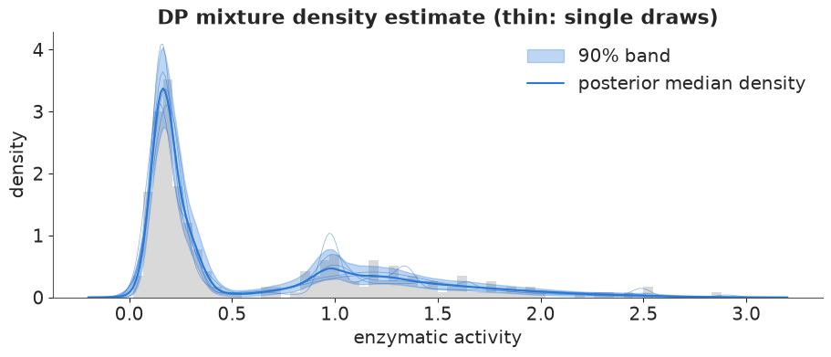

import LabelDiagnostics from "@/components/figures/dpm/LabelDiagnostics.astro";
import PriorSetsCount from "@/components/figures/dpm/PriorSetsCount.astro";
import StickBreaking from "@/components/figures/dpm/StickBreaking.astro";
import ThreeCounts from "@/components/figures/dpm/ThreeCounts.astro";

Fitting a finite mixture means picking the number of components, $K$, and then defending it. The Dirichlet process (DP) mixture offers a way out: put a prior on mixtures with an unbounded number of components and let the data decide how many get used.

I tested that promise in a [worked example](https://redam94.github.io/pymc-challenges/examples/E26_dirichlet_process_mixtures.html) on the enzyme data of Richardson & Green (1997): the activity of an enzyme that metabolises carcinogenic substances, measured in the blood of 245 unrelated people. The biological question is whether the population splits into slow and fast metabolisers. The fit answered that question clearly. It did not answer "how many clusters," because that phrase turned out to name three different quantities, and the prior set the one people usually mean.

## Two groups, but not two bell curves

About two thirds of the people sit in a tight pile near 0.2. The rest spread from about 0.6 to 2.9 in a wide, right-skewed hump. A mixture of normals needs more than two components to draw that shape, which is the first thing to hold on to: a mixture component is a kernel, not a population.



_The enzyme data (grey histogram) with the density estimate from the fit described below. Figure from the worked example._

## Stick-breaking: infinitely many weights from one parameter

A DP mixture says there are infinitely many components, with weights $w_1, w_2, \dots$ that sum to one. The weights come from breaking a stick of length 1. Break off a fraction $v_1$, and that piece is $w_1$. Break a fraction $v_2$ off what is left, and that is $w_2$. Continue without end:

$$w_k = v_k \prod_{\ell \lt k} (1 - v_\ell), \qquad v_k \sim \text{Beta}(1, \alpha)$$

Each component draws its own parameters from a base distribution $G_0$. The single concentration parameter $\alpha$ sets how fast the stick is used up: small $\alpha$ gives a few big weights, large $\alpha$ gives many small ones.

<StickBreaking />

That makes $\alpha$ a prior on the number of clusters. With $n$ observations, the number of occupied components $K_n$ has a prior that depends only on $\alpha$ and $n$:

$$E[K_n] = \sum_{i=1}^{n} \frac{\alpha}{\alpha + i - 1} \approx \alpha \log\left(1 + \frac{n}{\alpha}\right)$$

For the 245 people, $\alpha = 0.2$ expects about two clusters and $\alpha = 5$ about twenty. The popular hyperprior $\alpha \sim \text{Gamma}(2, 1)$ is not neutral either: it spreads the prior over 2 to 21 occupied clusters, with a median of 9. The expected count also keeps growing with $n$. That is a modelling assumption (new data keep revealing new kinds), and not an obvious one for a genetic polymorphism.

## The truncation that makes it a PyMC model

NUTS cannot sample infinitely many sticks, so the model truncates at $T$ components and gives the last weight the rest of the stick. The prior mass beyond $T$ averages $(\alpha / (1 + \alpha))^{T-1}$, which is about $4 \times 10^{-4}$ for $\alpha \approx 2$ and $T = 20$. The truncated model is

$$y_i \sim \sum_{k=1}^{T} w_k\,\text{Normal}(\mu_k, \sigma_k), \qquad w \sim \text{SB}_T(\alpha), \qquad \alpha \sim \text{Gamma}(2, 1)$$

```python
T = 20

with pm.Model() as dp:
    alpha = pm.Gamma("alpha", 2.0, 1.0)
    w = pm.StickBreakingWeights("w", alpha=alpha, K=T - 1)
    mu = pm.Normal("mu", y.mean(), 2 * y.std(), shape=T)
    sigma = pm.InverseGamma("sigma", 2.0, 0.1, shape=T)
    pm.NormalMixture("y", w=w, mu=mu, sigma=sigma, observed=y)
```

`pm.StickBreakingWeights` takes `K` as the number of breaks, so `K=T - 1` returns $T$ weights. `pm.NormalMixture` marginalises the discrete assignments, which leaves a continuous model that NUTS can sample. Everything else depends on that. The inverse-gamma prior on $\sigma_k$ matters too: a normal mixture's likelihood is unbounded when one component shrinks onto a single point, and this prior puts no mass near zero.

The fit took 17 seconds with no divergences. Truncation needs its own check, because if $T$ were too small the last weight would be visibly positive. Here it averages $2.6 \times 10^{-4}$, and the 99th percentile of the total weight in the last five components is 1.5%. Twenty components were enough.

## Labels switch, so the usual table fails

The standard summary table for this fit looks alarming: $\hat R$ up to 1.36 for the component means, and bulk effective sample sizes below 10 for some of them. This is not a sampling failure. The same density can be written with the components in a different order, so "$\mu_3$" has no meaning of its own across chains. Stick-breaking tempers the problem, since component 1 tends to be the biggest, but does not remove it.

The repair is to diagnose quantities that do not care what the components are called: $\alpha$, the log density, and the fitted density $f(x) = \sum_k w_k\,\text{Normal}(x \mid \mu_k, \sigma_k)$ at a grid of points.

<LabelDiagnostics />

The same rule decides what can be reported. The mean of component 3 cannot. Three things can: the density with its uncertainty band, the probability that two people share a cluster, and a single partition chosen by a stated loss.

## Three numbers of clusters

Three quantities could be called the number of clusters:

1. The number of components: $T = 20$ by construction, and infinite for the untruncated process.
2. The number of occupied clusters, $K_{\text{occ}}$: the number of distinct labels when each person is allocated to a component. The assignments were marginalised out, so they are drawn back afterwards, with person $i$ going to component $k$ with probability proportional to $w_k\,\text{Normal}(y_i \mid \mu_k, \sigma_k)$.
3. The number of components with non-negligible weight, say more than 0.02.

<ThreeCounts />

They disagree. $K_{\text{occ}}$ has a median of 7 and a long right tail, because under the DP prior a new cluster is always possible and a single outlying value is cheaply explained by one. Counting only components with more than 2% of the weight, or clusters with at least 5 people, gives 4 or 5. None of them is 2, the number of biological groups: the fast group is skewed, and normal kernels need two or three to draw it.

Compared with the prior, the data ruled out one to three clusters and very many clusters, but the posterior of $K_{\text{occ}}$ stayed wide. Miller & Harrison (2014) showed this is not a small-sample accident: the DP mixture posterior of the number of clusters is inconsistent, and does not concentrate on the true number even with infinitely many observations from a finite mixture.

## Who belongs with whom

Labels switch, but pairs do not. The posterior similarity matrix $P_{ij}$, the probability that persons $i$ and $j$ are in the same cluster, is label-invariant.


_The co-clustering matrix from the worked example. People are sorted by activity, so clusters show up as blocks on the diagonal._

Nobody below about 0.45 is ever clustered with anybody above 0.6, so the slow/fast split is certain. The fast group is much less coherent: it is carved into two or three kernels in varying ways, and its pairwise probabilities sit between 0.3 and 0.8.

A report usually wants one partition, and the Bayesian answer is the one that minimises the posterior expected loss. Two losses are standard (Wade & Ghahramani 2018), and here they disagree. The partition that minimises the variation of information is 151 slow metabolisers, with activity up to 0.41, and 94 fast ones, from 0.47. Binder's loss keeps five clusters, splitting both groups and isolating two people around 0.5. Neither is "the" answer.

## The prior on the concentration decides the count

Refitting with $\alpha$ fixed at 0.2 and at 5, and once more with the truncation cut to $T = 5$, changes almost nothing about the density: the four posterior median densities are nearly indistinguishable. The count is another matter.

<PriorSetsCount />

The median of $K_{\text{occ}}$ runs from 4 to 14. With 245 observations the prior on $\alpha$ still decides the count, and learning $\alpha$ only moves the choice to the hyperprior.

The same refits expose two truncation failures. With $\alpha = 5$ the last of 20 components carries 1.7% of the mass on average. With $T = 5$ the last weight averages 0.23 and $K_{\text{occ}}$ piles against the ceiling. Neither failure shows in the density or in the sampler diagnostics. Only the last-weight check catches it.

## Where it breaks, and where it earns its keep

**Mixing between orderings.** The posterior has many unequal modes, one per plausible ordering of the components, and NUTS moves between them rarely. In the $\alpha = 0.2$ fit, one chain almost never visited $K_{\text{occ}} \le 3$ while the others did in 35% to 50% of their draws, and the density at 0.15 had $\hat R = 1.15$ with a bulk effective sample size of 19. Samplers that update the assignments directly handle this. NUTS on the marginalised model cannot.

**Counting.** If the count is the goal, a sparse finite mixture (Malsiner-Walli, Frühwirth-Schnatter & Grün 2016) is better behaved: ten components and a symmetric Dirichlet prior with a tiny parameter $e_0$, so superfluous components empty out. The recommended $e_0 = 0.01$ defeated NUTS, in one parameterisation with 70 divergences and in another with three chains that reported no divergences while frozen at step sizes of $10^{-5}$. With $e_0 = 0.05$ the sampler was healthy and the posterior put 75% on 4 or 5 occupied clusters. Its variation-of-information partition was the same 151 and 94.

**Prediction does not pick a count either.** By PSIS-LOO, two normal components are about 8 elpd behind the best model. From four components on, the finite mixtures, the DP and the sparse mixture are within 3.2 elpd of each other. That says it takes at least four normal kernels to draw a skewed density. It says nothing about how many kinds of people there are.

**A flexible distribution inside a bigger model.** This is where the DP mixture is most useful. The example's second dataset is the Mayo Clinic trial in primary biliary cholangitis: 1,945 bilirubin measurements on 312 patients, each with their own slope on the log scale. Replacing the Normal distribution of slopes with a DP mixture gave a sharp peak of near-stable patients, a shoulder, and a long right tail of progressors. The Normal, forced to be symmetric, put 18% of patients on a falling trajectory. The DP put 14% there, and 18% against 15% in the tail where bilirubin doubles within two years. The two models' intervals overlap, and the LOO difference is 6.7 elpd with a standard error of 7.4, so this is a shift of emphasis and not a decisive win.

## What to do in practice

1. **Simulate the prior on the occupied count before fitting.** $\alpha$ and $n$ fix it, and with 245 observations it still decided the posterior count.
2. **Truncate, then check the last weight.** Neither the density nor the sampler diagnostics warn when $T$ is too small.
3. **Diagnose label-free quantities.** Use the density on a grid, the log density and $\alpha$. Ignore $\hat R$ of the component parameters.
4. **Say which count you mean.** Components, occupied clusters and clusters with non-negligible weight are different numbers, and none of them is the number of populations when the kernel has the wrong shape.
5. **Report the similarity matrix with any single partition,** and name the loss that chose it.
6. **Use the DP for densities and for flexible distributions inside bigger models.** That is where it is reliable.

The DP mixture kept its promise in the narrow sense: I never chose $K$. What it gave back was a density, a certain slow/fast split, and a count that depends on a definition and a prior, both of which I still have to state.

---

_Further reading: the full [worked example](https://redam94.github.io/pymc-challenges/examples/E26_dirichlet_process_mixtures.html) has the data, every fit and the diagnostics. All empirical numbers above come from it. References, as cited there: Richardson & Green (1997), "On Bayesian analysis of mixtures with an unknown number of components," JRSS B 59:731; Miller & Harrison (2014); Wade & Ghahramani (2018); Malsiner-Walli, Frühwirth-Schnatter & Grün (2016)._
